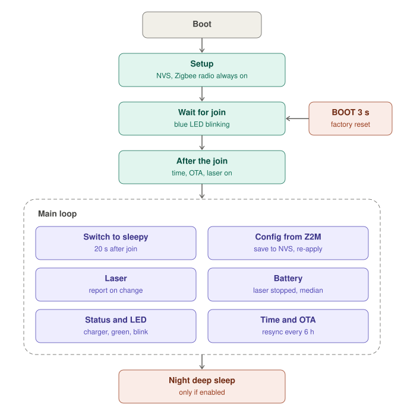
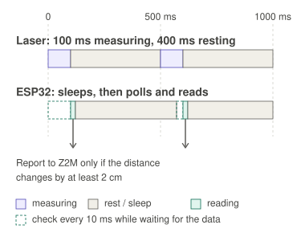
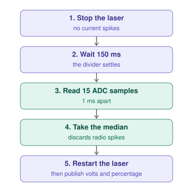

# Firmware internals (Arduino firmware)

How the [Arduino sketch](../arduino/README.md) is organised at run time: boot and join, the main loop, the laser cycle and the battery reading. Read this before changing timings or power settings.

## Overview

- **Boot** always starts with the radio on, so the device rejoins the saved network reliably. The earlier approach (reboot into a sleepy configuration) failed to rejoin and is not used any more.
- **Switch to sleepy** runs at run time, 20 s after the join (3 minutes after the very first pairing, to let the Zigbee2MQTT interview finish). It sets `rx_on_when_idle` off, a long poll interval and stack light sleep. At the time of writing `esp_zb_get_rx_on_when_idle()` still reports `1` after the switch, so the radio stays on: this is under investigation. Reports to the coordinator work either way.
- **Config from Z2M**: writes arrive in the Zigbee task, which only updates the in-memory values and raises a flag. The loop then validates them, saves them to NVS and publishes them back, so the Zigbee task never does heavy I/O.
- **Night deep sleep** happens only when enabled, the time is synced, the charger is not connected and no OTA is running or recent (10-minute window after each boot).

## Laser cycle

The VL53L1X runs autonomously with a **timing budget of 100 ms** and an **inter-measurement period equal to `ReadIntervalMs`** (minimum 100 ms). So with `ReadIntervalMs = 500` one cycle is 100 ms measuring plus 400 ms resting, and with 1000 it is 100 ms plus 900 ms. Changing the interval from Home Assistant stops the laser, reconfigures the period and restarts it.

The ESP32 does not drive the cycle, it only collects the result: after each reading it sleeps until about 30 ms before the next one is ready, then polls every 10 ms. A change is therefore reported with at most a few milliseconds of delay, not a whole interval.

Example with `ReadIntervalMs = 500`. Hatched boxes are the 10 ms checks just before the result is ready.

| Part | Meaning |
| :--- | :--- |
| `M` | Laser measuring, 100 ms (`LASER_BUDGET_MS`) |
| rest | Laser idle until the next period |
| `R` | ESP32 reads the result and decides whether to report |
| sleep | ESP32 `delay()`: with sleep enabled the CPU can enter light sleep |
| polling | A few 10 ms checks just before the result is ready (dashed boxes in the drawing) |

## Battery reading

The battery is read every 10 minutes (every minute with the charger connected, and immediately when the charger is plugged or unplugged). The **first** reading after boot is made 60 s after the join (`BATTERY_FIRST_DELAY_MS`), to skip the low voltages seen right after a start-up.

- The median (not the average) removes single outliers, such as a radio transmission happening during the read.
- The laser is stopped for about 200 ms, so one laser measurement can be skipped every 10 minutes.
- Volts are always published. The percentage is published only on battery, 2 minutes after the charger was removed (`BATTERY_SETTLE_MS`); at charge complete it is 100.

## Related constants

| Constant | Value | Where it matters |
| :--- | :--- | :--- |
| `LASER_BUDGET_MS` | 100 | Laser measuring time per cycle |
| `BATTERY_PRE_SETTLE_MS` | 150 | Wait with the laser stopped, before the ADC read |
| `BATTERY_FIRST_DELAY_MS` | 60000 | First battery reading after the join |
| `ADC_SAMPLES` | 15 | Samples per reading (median) |
| `PAIRING_SETTLE_MS` | 180000 | Time before switching to sleepy after the first pairing |
| `SLEEPY_DELAY_MS` | 20000 | Time before switching to sleepy on a normal boot |
| `ZB_POLL_INTERVAL_MS` | 4000 | Long poll interval used for the sleepy switch |
